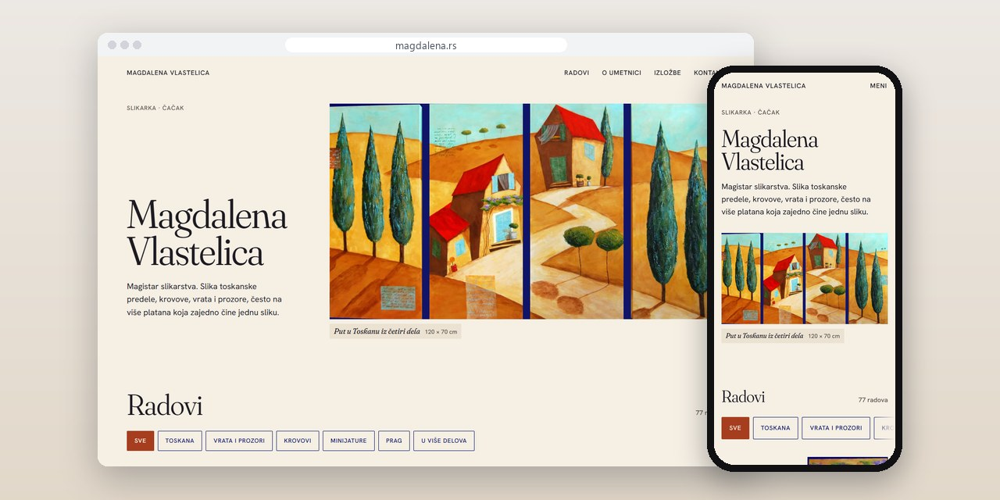
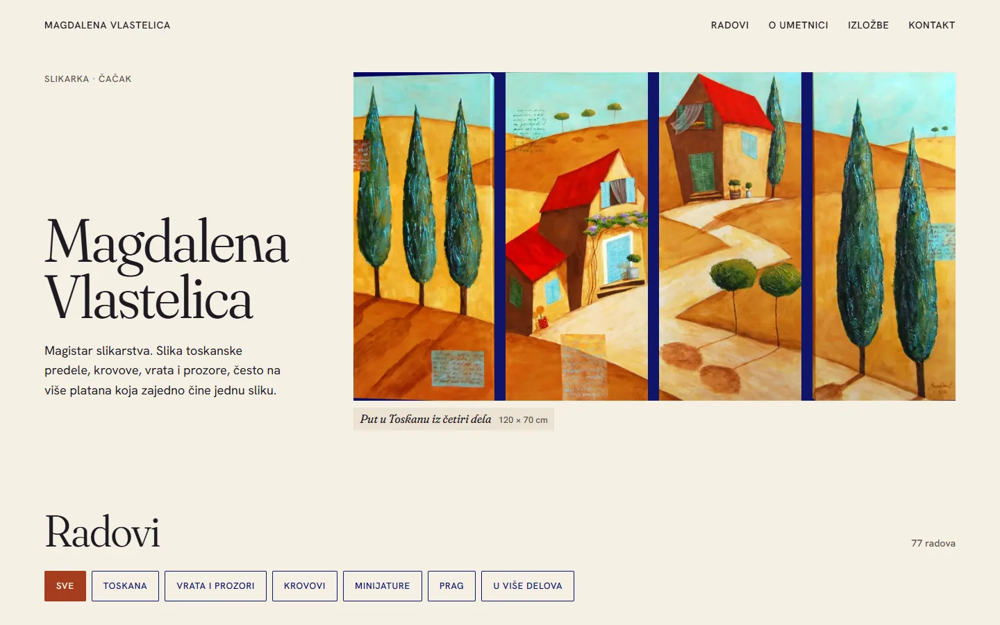
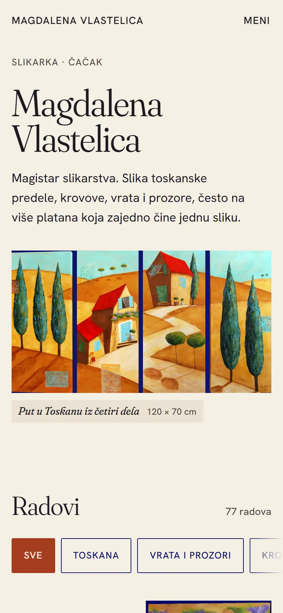
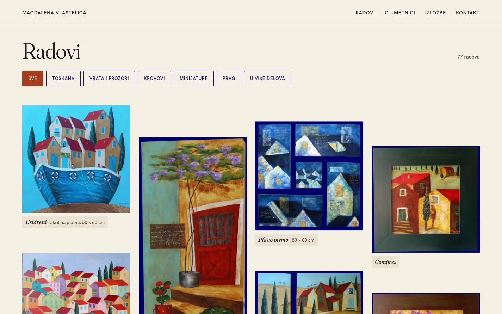
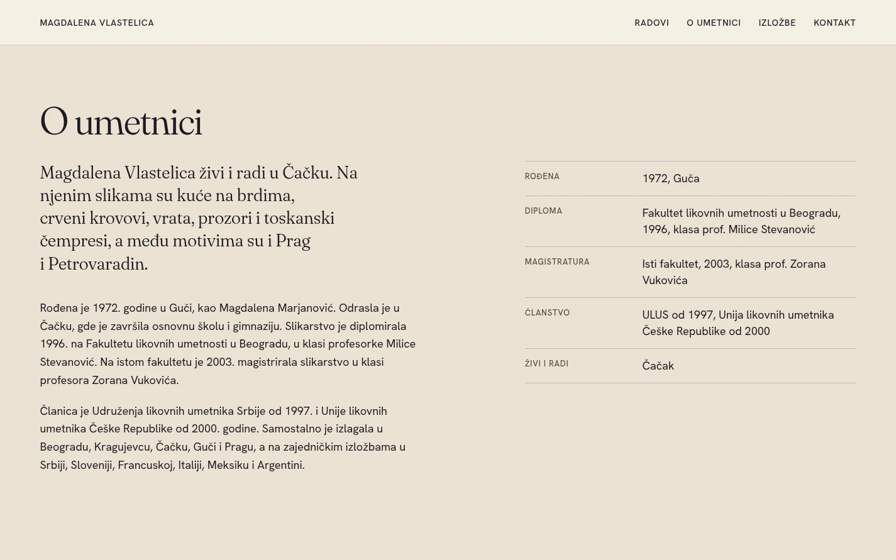

# Magdalena Vlastelica

One-page website for a painter from Čačak: a gallery of her works chosen by motif, her biography and exhibitions, and a panel she uses from her phone.

**[magdalena.rs](https://magdalena.rs/)** · [Case study (in Serbian)](https://svilenkovic.rs/radovi/magdalena-vlastelica) · [Srpski](README.sr.md)

> [!NOTE]
> Client project. The source code belongs to the client and stays in a private repository. This page describes what I built and how.

<table>
  <tr><td><b>Client</b></td><td>Magdalena Vlastelica</td></tr>
  <tr><td><b>Industry</b></td><td>Painting</td></tr>
  <tr><td><b>Location</b></td><td>Čačak, Serbia</td></tr>
  <tr><td><b>Type</b></td><td>One-page website</td></tr>
  <tr><td><b>My role</b></td><td>Redesign, development, migration and hosting</td></tr>
  <tr><td><b>Stack</b></td><td>PHP 8.5, SQLite, AVIF, WebP, GSAP, nginx</td></tr>
</table>

## About the project

Magdalena Vlastelica is a painter from Čačak with a master's degree in painting. She paints Tuscan landscapes, roofs, doors and windows, often on several canvases that make one painting. Her old site held her works, and she needed a new one where the paintings come first and where she can add new work herself.

I moved 69 works from the old site with their original photos and kept the old image addresses working through redirects. The gallery now has 77 works. She adds new ones from a panel built for her phone: she picks a photo, types the title, the size and the group, and the site makes the smaller AVIF and WebP versions on its own.

## What I built

- One page in four parts: works, about the artist, exhibitions and contact
- A gallery of 77 works with a choice by motif: Tuscany, doors and windows, roofs, miniatures, Prague and paintings in several parts
- An enlarged view of every work with its own address, so one painting can be shared with a link
- Every photo in several widths, in AVIF and WebP, with 24 works shown first on a phone
- A phone panel to add, edit, reorder, hide and delete works, with the login locked after several wrong attempts
- Structured data for the artist's profile, her education and memberships, and every work as an artwork

## Results

| | Performance | Accessibility | Best practices | SEO |
| :-- | :-: | :-: | :-: | :-: |
| Mobile | 100 | 100 | 100 | 100 |
| Desktop | 100 | 100 | 100 | 100 |

PageSpeed Insights, lab test of the live site, November 2026. Security headers: 6 of 6. HTML validator: no errors. axe accessibility check: no violations. Structured data: `ItemList`, `Person`, `ProfilePage`.

## Screenshots

<table>
  <tr>
    <td width="68%" valign="top"></td>
    <td width="32%" valign="top"></td>
  </tr>
</table>

The gallery of works with a choice by motif

About the artist: biography, education and memberships

---

Built by [D. Svilenković](https://svilenkovic.com).
