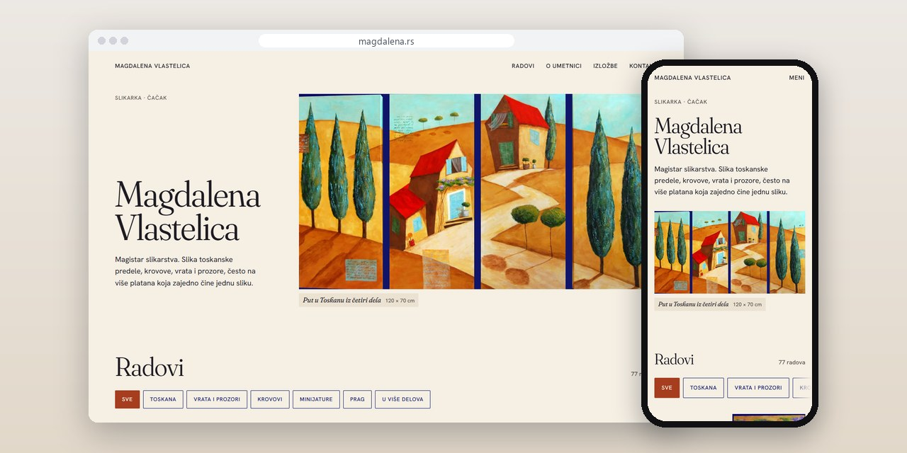
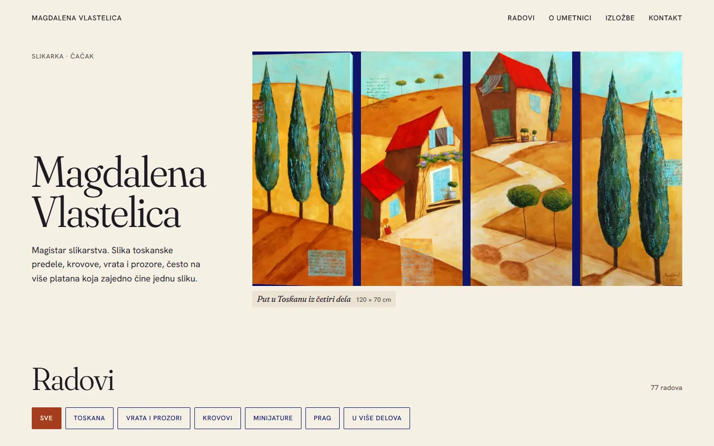
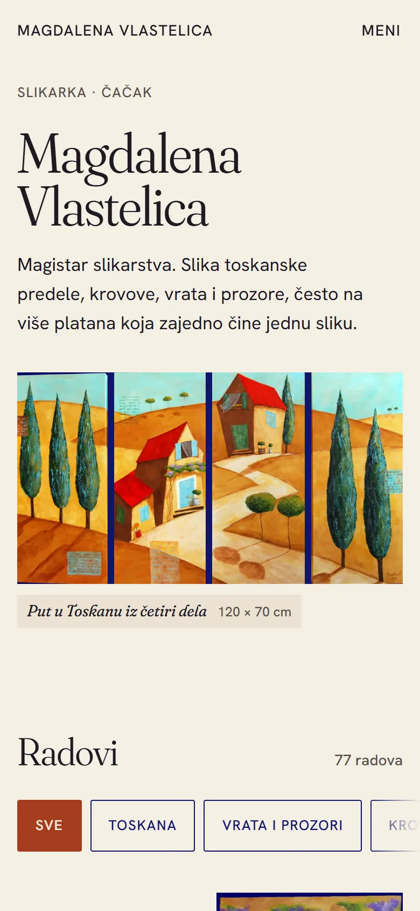
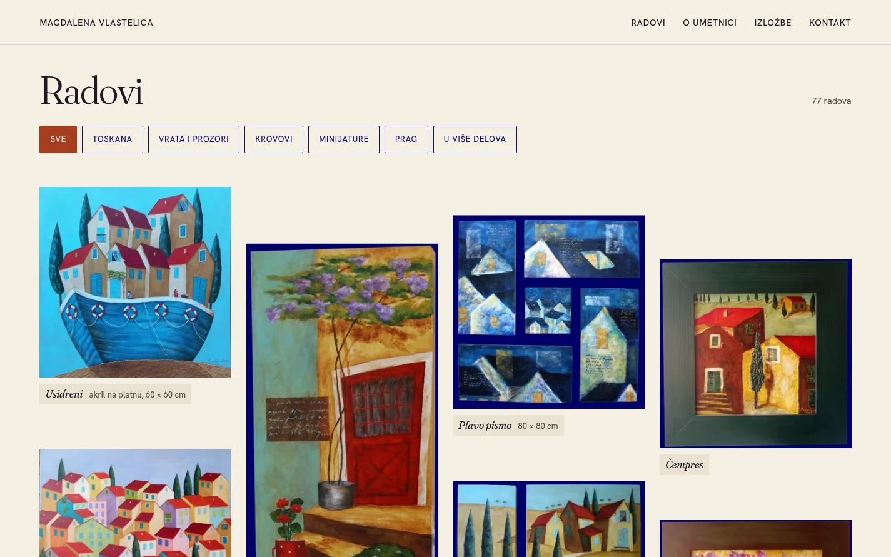
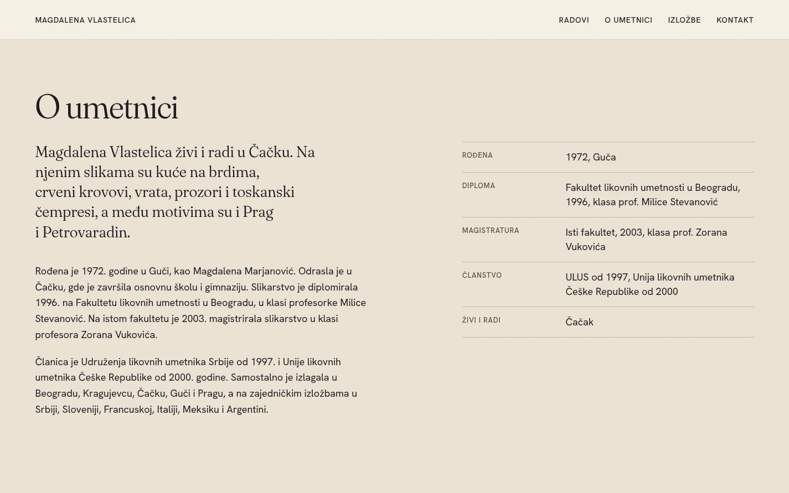

# Magdalena Vlastelica

Sajt na jednoj strani za slikarku iz Čačka: galerija radova sa izborom po motivu, biografija i izložbe, i panel koji koristi sa telefona.

**[magdalena.rs](https://magdalena.rs/)** · [Studija slučaja](https://svilenkovic.rs/radovi/magdalena-vlastelica) · [English](README.md)

> [!NOTE]
> Klijentski projekat. Izvorni kod pripada klijentu i čuva se u privatnom repozitorijumu. Ova stranica opisuje šta sam uradio i kako.

<table>
  <tr><td><b>Klijent</b></td><td>Magdalena Vlastelica</td></tr>
  <tr><td><b>Delatnost</b></td><td>Slikarstvo</td></tr>
  <tr><td><b>Lokacija</b></td><td>Čačak</td></tr>
  <tr><td><b>Vrsta</b></td><td>Sajt na jednoj strani</td></tr>
  <tr><td><b>Moj deo posla</b></td><td>Redizajn, izrada, selidba i hosting</td></tr>
  <tr><td><b>Tehnologije</b></td><td>PHP 8.5, SQLite, AVIF, WebP, GSAP, nginx</td></tr>
</table>

## O projektu

Magdalena Vlastelica je slikarka iz Čačka, magistar slikarstva. Slika toskanske predele, krovove, vrata i prozore, često na više platana koja čine jednu sliku. Stari sajt je imao njene radove, a trebao joj je nov, na kome su slike u prvom planu i na koji sama dodaje nove radove.

Sa starog sajta preneo sam 69 radova sa originalnim fotografijama, a stare adrese slika vode na nove preko preusmerenja. Galerija sada ima 77 radova. Nove dodaje iz panela pravljenog za telefon: izabere fotografiju, upiše naziv, dimenzije i grupu, a sajt sam napravi manje verzije u AVIF i WebP formatu.

## Šta sam uradio

- Jedna strana u četiri dela: radovi, o umetnici, izložbe i kontakt
- Galerija od 77 radova sa izborom po motivu: Toskana, vrata i prozori, krovovi, minijature, Prag i slike u više delova
- Uvećan prikaz svakog rada sa sopstvenom adresom, pa se jedna slika može poslati linkom
- Svaka fotografija u više širina, u AVIF i WebP formatu, a na telefonu se prvo prikazuju 24 rada
- Panel za telefon u kome se radovi dodaju, menjaju, premeštaju, sklanjaju i brišu, sa prijavom koja se zaključava posle više pogrešnih pokušaja
- Strukturisani podaci za profil umetnice, njeno školovanje i članstva i svaki rad kao umetničko delo

## Merenja

| | Performanse | Pristupačnost | Dobre prakse | SEO |
| :-- | :-: | :-: | :-: | :-: |
| Telefon | 100 | 100 | 100 | 100 |
| Desktop | 100 | 100 | 100 | 100 |

PageSpeed Insights, laboratorijsko merenje živog sajta, novembar 2026. Sigurnosna zaglavlja: 6 od 6. HTML validator: bez grešaka. axe provera pristupačnosti: bez prekršaja. Strukturisani podaci: `ItemList`, `Person`, `ProfilePage`.

## Snimci ekrana

<table>
  <tr>
    <td width="68%" valign="top"></td>
    <td width="32%" valign="top"></td>
  </tr>
</table>

Galerija radova sa izborom po motivu

O umetnici: biografija, školovanje i članstva

---

Izrada: [D. Svilenković](https://svilenkovic.rs).
